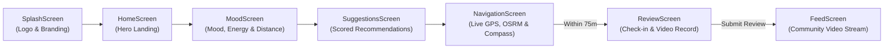

<div align="center">

# 🧭 ROVEYA
### *Find the 5-star in 1-star spots.*

A Flutter mobile app that flips conventional travel ratings on its head — sending travelers to overlooked 1-star legacy places specifically for their verified 5-star standout features.

[](https://flutter.dev)
[](https://dart.dev)
[](https://supabase.com)
[](https://www.openstreetmap.org)
[](https://android.com)
[](LICENSE)

---

</div>

## 📌 Table of Contents

- [The Problem & The Solution](#-the-problem--the-solution)
- [How It Works](#-how-it-works)
- [Key Features](#-key-features)
- [Tech Stack](#-tech-stack)
- [Project Architecture](#-project-architecture)
- [Prerequisites](#-prerequisites)
- [Quick Start](#-quick-start)
- [Configuration](#-configuration)
- [Database Setup (Supabase)](#-database-setup-supabase)
- [Build APK](#-build-apk)
- [Device Permissions](#-device-permissions)
- [Demo Presentation Mode](#-demo-presentation-mode)
- [Troubleshooting](#-troubleshooting)
- [License](#-license)

---

## 💡 The Problem & The Solution

| The Problem | Roveya's Solution |
| :--- | :--- |
| **Consensus Bias**: Mainstream apps funnel every traveler to the same 5-star tourist traps. | **Uncover The Overlooked**: Routes users to low-rated legacy spots with unique character. |
| **Unfair Legacy Ratings**: Places receive 1-star reviews for bad parking, worn chairs, or slow Wi-Fi. | **Spotlight Standout Features**: Highlights the *one thing* that earns 5 stars (sunset view, secret recipe, banyan silence, maker community). |
| **Fake & Text-only Reviews**: Anonymous text reviews lack authenticity. | **Verified Video Proof**: Video reviews recorded directly on-site with 75m GPS proximity verification. |

---

## 🔄 How It Works



1. **Vibe Match**: Pick your mood (*Calm, Curious, Adventurous, Reflective, Social*), energy level, and walking radius.
2. **Scored Spots**: Algorithm ranks legacy 1-star places based on mood alignment and proximity.
3. **Smooth Navigation**: Follow live turn-by-turn road routes with 60/120 FPS continuous heading auto-follow.
4. **Proximity Unlock**: Check-in unlocks automatically when you arrive within **75 meters** of the spot.
5. **Video Proof**: Record and upload a 5-star feature video review directly to Supabase cloud storage.
6. **Community Feed**: Every traveler across all devices can watch the real uploaded video review with inline playback.

---

## 🌟 Key Features

- **Multi-Mood Selection**: Select single or multiple moods simultaneously to tailor recommendations.
- **Unrestricted Distance**: Freeform distance input in meters or kilometers with quick chips (`400 m`, `500 m`, `1 km`, `3 km`, etc.).
- **Smooth 60/120 FPS Heading Animation**: Compass bearing uses shortest-arc angular lerp (`_lerpAngle`) to eliminate 360° jump stuttering during walking.
- **Real Video Cover Thumbnails**: Community review cards decode the actual uploaded video stream to display real video frames as thumbnails.
- **Multi-Device Cloud Sync**: Real-time Supabase Database and Storage backend shared across all installed APKs.
- **Offline Resilience**: User-submitted reviews are saved to on-device persistent JSON storage so content is never lost if network drops.
- **Artisan Retro Travel Aesthetic**: Warm retro theme (`C.cream`, `C.ocean`, `C.butter`, `C.peach`) and custom vector Compass Rose & Star logo widget.
- **TinkerSpace Calicut Demo Spot**: Built-in walking demo destination anchored ~290 m from Kozhikode campus for live presentations.
- **Desk Testing Walk Simulator**: Built-in "Simulate walk" button for desk demos without having to walk outside.

---

## 🛠️ Tech Stack

| Area | Tools & Packages |
| :--- | :--- |
| **UI Framework** | [Flutter 3.x](https://flutter.dev) (Dart 3.x) with Material 3 |
| **Backend & Storage** | [Supabase](https://supabase.com) (PostgreSQL, Supabase Storage, Row Level Security) |
| **Map & Navigation** | [flutter_map](https://pub.dev/packages/flutter_map) + [latlong2](https://pub.dev/packages/latlong2) + OpenStreetMap Tiles |
| **Road Routing** | [OSRM](http://project-osrm.org/) (Open Source Routing Machine) |
| **Device Location** | [geolocator](https://pub.dev/packages/geolocator) (High Accuracy GPS streams) |
| **Media & Video** | [video_player](https://pub.dev/packages/video_player) + [image_picker](https://pub.dev/packages/image_picker) |
| **File Storage** | [path_provider](https://pub.dev/packages/path_provider) |
| **Typography** | [google_fonts](https://pub.dev/packages/google_fonts) (Nunito & Caveat) |

---

## 📂 Project Architecture

```text
layover/
├── .gitignore                      # Root workspace gitignore (Flutter, Android, iOS, IDE)
├── README.md                       # Main project documentation
└── layoverApp/                     # Flutter mobile application
    ├── lib/
    │   ├── main.dart               # App entry point (Splash -> Home)
    │   ├── config.dart             # Configuration, API keys, arrival radius
    │   ├── theme.dart              # Color palette & Google Fonts typography
    │   ├── models.dart             # Place, Review, RouteInfo data models
    │   ├── screens/
    │   │   ├── splash_screen.dart       # Animated brand intro splash screen
    │   │   ├── home_screen.dart         # Home landing & action navigation
    │   │   ├── mood_screen.dart         # Multi-mood & distance input screen
    │   │   ├── suggestions_screen.dart  # Scored place recommendations
    │   │   ├── navigation_screen.dart   # Live map, smoothed compass, GPS tracking
    │   │   ├── review_screen.dart       # Proximity check-in, camera video record
    │   │   └── feed_screen.dart         # Community reviews feed with video playback
    │   ├── services/
    │   │   ├── backend.dart             # Supabase client, offline sync & persistence
    │   │   ├── location_service.dart    # GPS stream, Haversine math & OSRM routing
    │   │   ├── osm_places.dart          # OpenStreetMap Overpass API integration
    │   │   └── google_places.dart       # Optional Google Places integration
    │   └── widgets/
    │       ├── roveya_logo.dart         # Vector-drawn compass logo widget
    │       └── common.dart              # SoftCard, TagPill, StarRow, CoastPainter
    ├── supabase/
    │   ├── schema.sql              # Database schema, RLS policies, storage bucket
    │   └── add_tinkerspace.sql     # TinkerHub Calicut demo place & sync setup
    └── pubspec.yaml                # Flutter dependencies & metadata
```

---

## 📋 Prerequisites

- **Flutter SDK**: `>=3.3.0 <4.0.0`
- **Dart SDK**: bundled with Flutter
- **Android Studio** or **VS Code** with Flutter extension
- An Android device or emulator with Location permissions enabled

---

## 🚀 Quick Start

```bash
# 1. Clone the repository
git clone https://github.com/uditya22-flux/LAYOVER123.git
cd LAYOVER123/layoverApp

# 2. Install dependencies
flutter pub get

# 3. Analyze code quality
flutter analyze

# 4. Run tests
flutter test

# 5. Launch app on connected device
flutter run
```

---

## ⚙️ Configuration

Application settings and feature flags are managed in [`layoverApp/lib/config.dart`](layoverApp/lib/config.dart):

```dart
// Supabase Project Credentials
const supabaseUrl = 'https://YOUR_PROJECT.supabase.co';
const supabaseAnonKey = 'YOUR_SUPABASE_ANON_KEY';

// Default search distance in km (unrestricted)
const kDefaultRadiusKm = 1.0;

// Proximity radius in meters required to unlock check-in
const kArrivalRadiusM = 75.0;

// Set to true ONLY for desk presentations to bypass the 75m requirement
const kDemoUnlock = false;
```

---

## 🗄️ Database Setup (Supabase)

1. Create a project at [supabase.com](https://supabase.com).
2. Open the **SQL Editor** in your Supabase dashboard.
3. Run [`layoverApp/supabase/schema.sql`](layoverApp/supabase/schema.sql) to set up:
   - `places` table with public read policy
   - `reviews` table with public read/insert policies
   - `review-videos` public storage bucket with upload policies
4. Run [`layoverApp/supabase/add_tinkerspace.sql`](layoverApp/supabase/add_tinkerspace.sql) to register the TinkerHub Calicut Gate demo spot.

---

## 📦 Build APK

To generate a standalone APK for testing across multiple devices:

```bash
cd layoverApp

# Build debug APK
flutter build apk --debug

# Build release APK
flutter build apk --release
```

The compiled APK will be located at:
```text
layoverApp/build/app/outputs/flutter-apk/app-debug.apk
```

---

## 📱 Device Permissions

### Android (`android/app/src/main/AndroidManifest.xml`)
```xml
<uses-permission android:name="android.permission.INTERNET"/>
<uses-permission android:name="android.permission.ACCESS_FINE_LOCATION"/>
<uses-permission android:name="android.permission.ACCESS_COARSE_LOCATION"/>
<uses-permission android:name="android.permission.CAMERA"/>
<uses-permission android:name="android.permission.RECORD_AUDIO"/>
```

### iOS (`ios/Runner/Info.plist`)
```xml
<key>NSLocationWhenInUseUsageDescription</key>
<string>We need your location to find standout hidden spots near you.</string>
<key>NSCameraUsageDescription</key>
<string>We need camera access so you can record your 5-star video review.</string>
<key>NSMicrophoneUsageDescription</key>
<string>We need microphone access to capture audio with your video review.</string>
<key>NSPhotoLibraryUsageDescription</key>
<string>Pick an existing video from your gallery to share as a review.</string>
```

---

## 🎪 Demo Presentation Mode

- **Live Walking Demo**: Select `500 m` (or `400 m`) on the mood screen to highlight **TinkerHub Calicut Gate**, walk ~290 m to the gate to unlock check-in, and record a live video review.
- **Desk Demo**: Tap the **Simulate walk** button on the map screen to test real-time GPS movement, shortest-arc compass turning, and proximity countdown without leaving the room.
- **Emergency Bypass**: Set `kDemoUnlock = true` in `lib/config.dart` to keep check-in unlocked regardless of distance.

---

## ❓ Troubleshooting

- **Supabase not connecting**: Verify `supabaseUrl` and `supabaseAnonKey` in `layoverApp/lib/config.dart`.
- **Location permissions**: Ensure GPS is enabled and set to High Accuracy on your device.
- **Missing spots**: Run [`add_tinkerspace.sql`](layoverApp/supabase/add_tinkerspace.sql) in Supabase SQL editor to ensure demo spots are seeded.
- **Video preview**: Review cards decode the first frame (~200ms) of the video file; tap the card to play.

---

## 📄 License

This project is licensed under the MIT License — see the [LICENSE](LICENSE) file for details.

<div align="center">
<sub>Crafted with curiosity by the Roveya Team. Built for travelers who seek the extraordinary in the overlooked.</sub>
</div>
